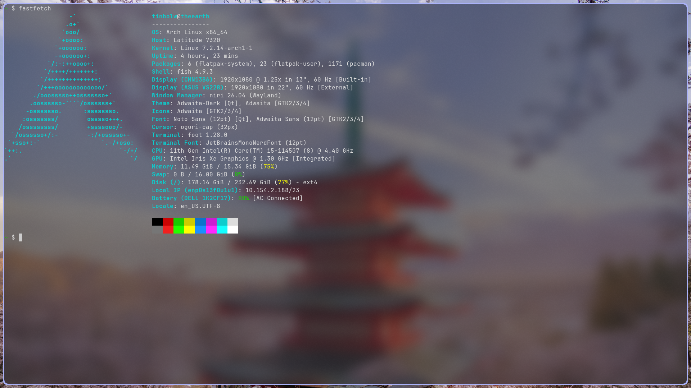
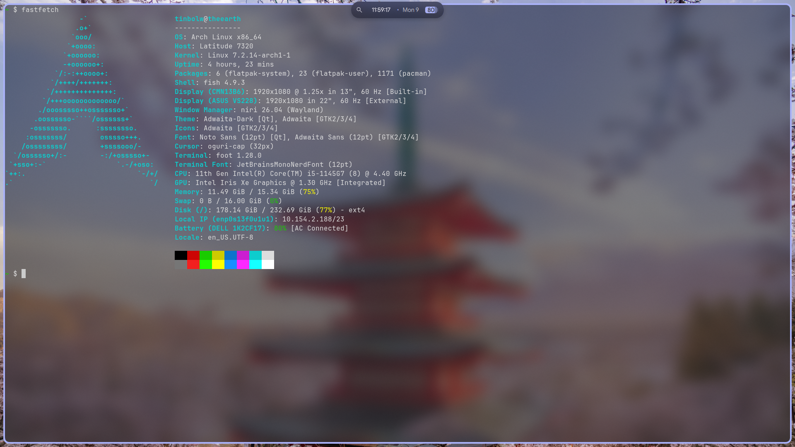
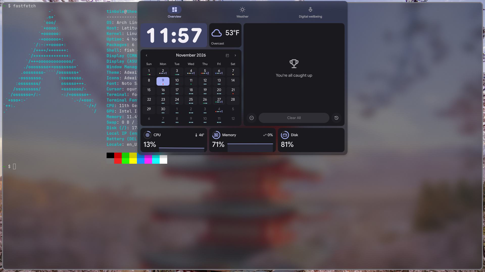
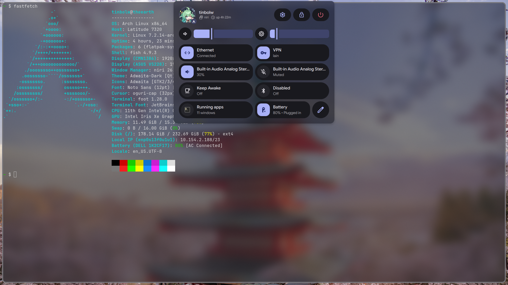

# dotfiles
Keeping it fast and simple.

## Hosts:
| Hostname | Host | Specs |
| - | - | - |
| theearth | Dell Latitude 7320 | [Link](/md/theearth.md) |
| theold | ThinkPad T480 | [Link](/md/theold.md) |

## Apps
|  |  |
| - | - |
| Bootloader | None (efibootmgr) |
| Color Generator | [Matugen](https://github.com/InioX/matugen) |
| Desktop Environment | [niri](https://github.com/niri-wm/niri) |
| Display Manager | None (getty) |
| File Manager | [nautilus](https://github.com/GNOME/nautilus) |
| Image Viewer | [Loupe](https://github.com/GNOME/loupe) |
| Music Player | [Decibels](https://github.com/GNOME/decibels) |
| Shell (includes Launcher) | [Dux Modular Shell](https://github.com/duxlabs-dev/dux-shell) |
| Terminal Emulator | [foot](https://codeberg.org/dnkl/foot) |
| Video Player | [mpv](https://github.com/mpv-player/mpv)|
| Wallpapers | [skwd-wall](https://github.com/liixini/skwd-wall)|

## Wallpapers
https://wallhaven.cc/user/tinbolw/favorites/2141087

## Gallery
### Desktop

### Bar

### Dash

### Settings
